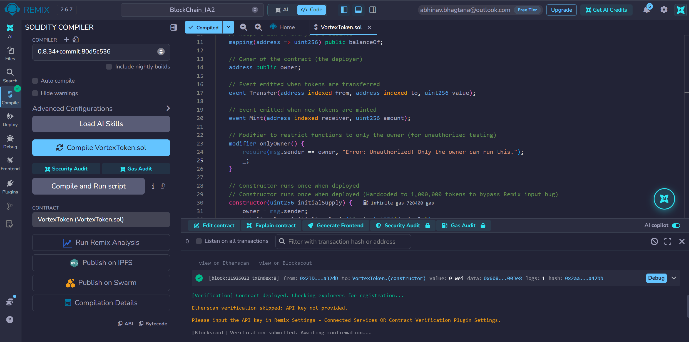
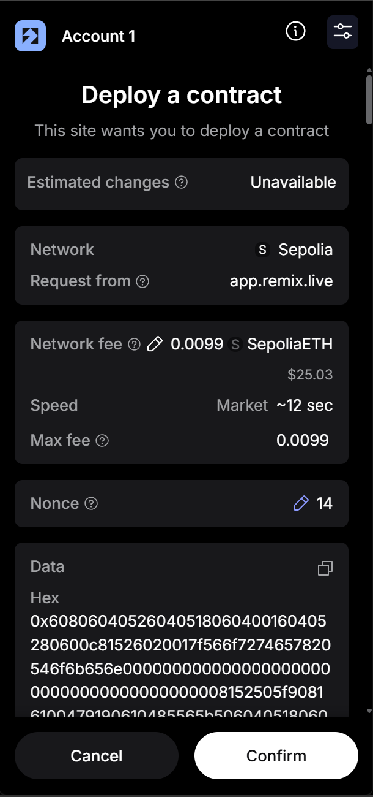
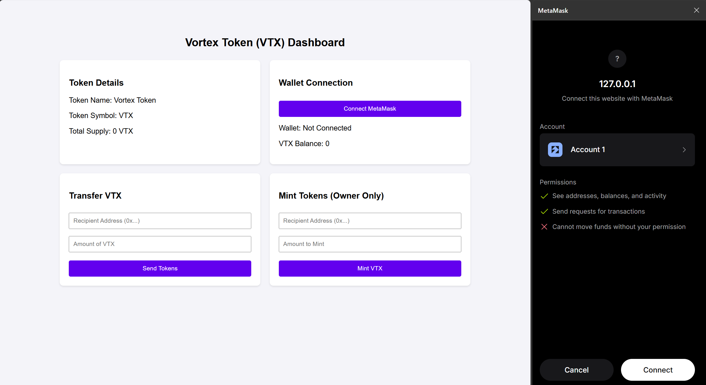
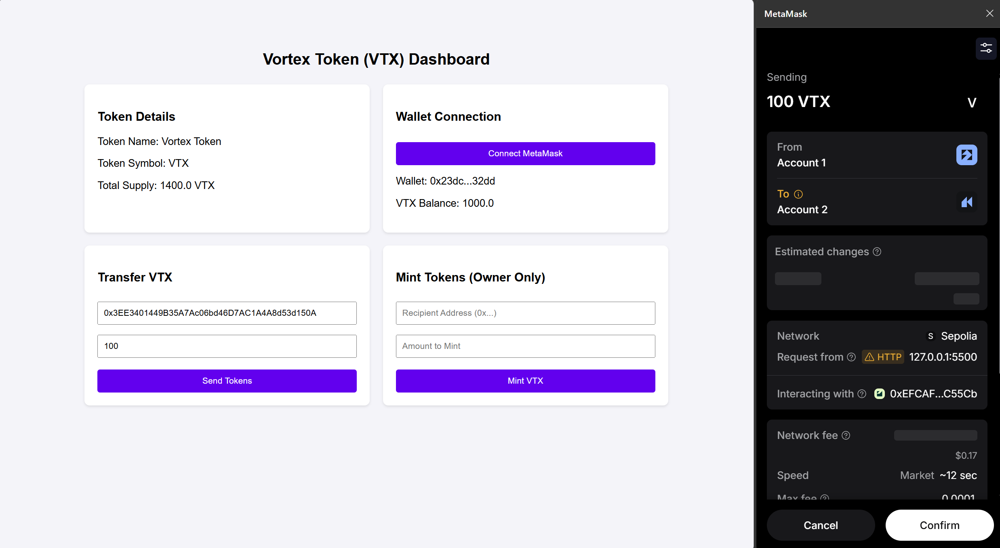
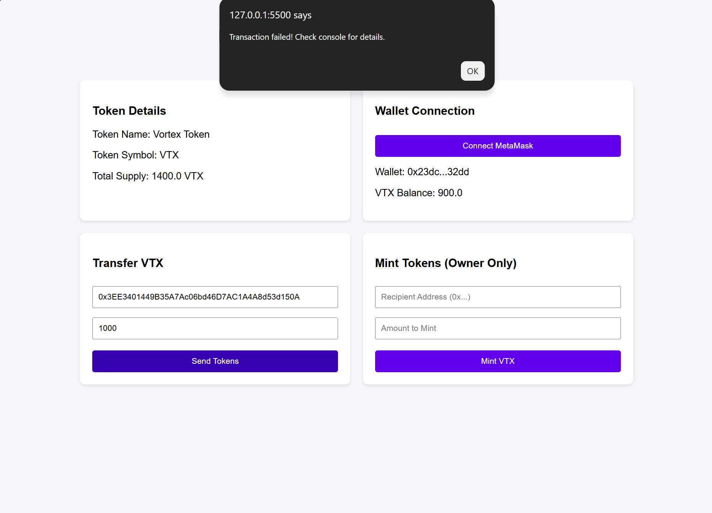
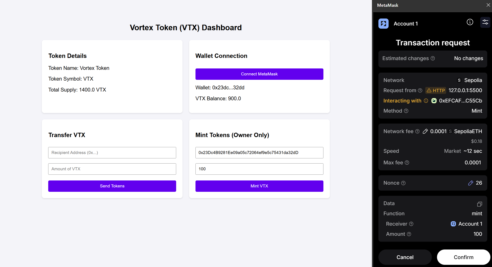
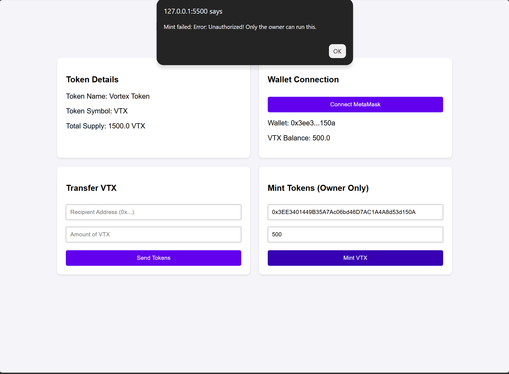
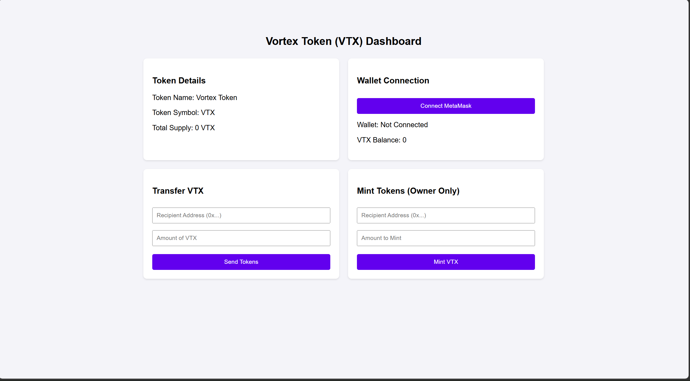

# Vortex Token (VTX) DApp

An original Decentralized Application (DApp) built on the Ethereum Sepolia Testnet that allows users to interact with a custom ERC-20 token interface. The project implements smart contract deployment, MetaMask integration, token transfers, and owner-restricted minting functionality.

---

## Problem Statement

Traditional digital asset and token management systems—such as platform credits, corporate loyalty points, or internal ledgers—rely heavily on centralized databases controlled by a single authority. This centralized architecture introduces several critical limitations:
1. **Lack of Transparency:** Users cannot independently verify token supply, transaction records, or ledger integrity without blindly trusting the central operator.
2. **Absence of True Ownership:** Central entities retain the unilateral power to alter user balances, freeze accounts, or shut down services without cryptographic recourse.
3. **Vulnerability to Trust-Based Control:** Administrative functions lack automated, immutable enforcement, making them susceptible to human error or policy manipulation.

### Proposed Solution
To resolve these issues, the **Vortex Token (VTX) DApp** implements a decentralized, trustless alternative on the Ethereum Sepolia Testnet. By combining a secure ERC-20 Solidity smart contract with an interactive web interface, this project delivers:
* **True User Ownership & Control:** Token balances and ownership are cryptographically secured by user private keys via MetaMask.
* **Transparent On-Chain Verification:** All data (such as total supply and wallet balances) is fetched and verified directly from the blockchain in real-time.
* **Role-Based Access Control:** Critical functions like token minting are strictly restricted to the authorized contract owner via immutable code (`onlyOwner`), while peer-to-peer transfers enable secure, trustless value exchange without intermediaries.

---

## Key Features
* MetaMask Wallet Connection: Dynamic wallet connection with status feedback.
* Blockchain Data Retrieval: Displays active token balance, total supply, token name, symbol, and contract owner address.
* Token Transfer: Allows users to transfer VTX tokens to any valid Ethereum address.
* Owner Minting: Enables the contract owner to mint additional tokens while restricting unauthorized accounts.

---

## Tech Stack
* Smart Contract: Solidity (^0.8.0)
* Development Environment: Remix IDE
* Blockchain Network: Ethereum Sepolia Testnet
* Frontend: HTML5, JavaScript (ES6+)
* Blockchain Integration: Ethers.js (v6) & MetaMask Extension

---

## Deployment Details
* Network Name: Sepolia Testnet
* Chain ID: 11155111
* Smart Contract Address: 0xEFCAFB64d86b0b0Bc5d67096B03D4C69278C55Cb

---

### Steps Required to Execute the Application Locally

1. **Prerequisites:**
   * Install the [MetaMask browser extension](https://metamask.io/).
   * Switch your MetaMask active network to the **Sepolia Testnet** and ensure you have Sepolia ETH for gas fees.

2. **Clone or Download the Repository:**
   * Download or clone your GitHub repository containing `index.html`, `app.js`, `abi.js`, and your smart contract source files.

3. **Configure the Contract Address:**
   * Open `app.js` in your code editor.
   * If you are deploying your own smart contract instance, update the contract address variable with your newly deployed Sepolia contract address. *(If using the pre-deployed project address, you can leave it as configured).*

4. **Launch the DApp:**
   * Open the `index.html` file locally in any modern web browser (or run it using a local development server like VS Code's *Live Server* extension).

---

### Steps to Connect MetaMask and Interact with the Smart Contract

1. **Connect Wallet:**
   * Click the **Connect MetaMask** button on the DApp dashboard.
   * A MetaMask popup will appear asking for permission to connect your account. Approve the connection request.
   * Once connected, your active wallet address and live VTX token balance will display dynamically on the user interface.

2. **Transfer Tokens:**
   * Enter a valid recipient Ethereum address (`0x...`) in the *Recipient Address* field.
   * Enter the desired amount of VTX tokens to send.
   * Click **Send Tokens**, review the gas fee in the MetaMask prompt, and confirm the transaction.

3. **Mint Tokens (Owner Only):**
   * Input the recipient's address and the amount of tokens you wish to create in the *Mint Tokens* section.
   * Click **Mint VTX**. 
   * If executed by the contract owner, MetaMask will prompt you to confirm the transaction, after which the total supply and balances update. If executed by any other account, the transaction will safely revert due to smart contract access validation.

## Test Cases & Results

* Valid Transfer:
  * Inputs Tested: Recipient: 0x... (valid), Amount: 100 VTX
  * Expected Result: Balance updates for both accounts; transaction succeeds on Sepolia.
  * Observed Result: Transaction confirmed; UI balances updated.
  * Status: PASS

* Invalid Transfer (Insufficient Balance):
  * Inputs Tested: Amount greater than user's VTX balance
  * Expected Result: Transaction fails or gets rejected with an insufficient balance error(console output).
  * Observed Result: MetaMask / Smart Contract reverts transaction with 'Insufficient balance!'.
  * Status: PASS

* Authorized Minting (Owner):
  * Inputs Tested: Receiver: 0x... (valid), Amount: 100 VTX (by deployer wallet)
  * Expected Result: Tokens minted, total supply and receiver balance increase.
  * Observed Result: Transaction succeeds, supply increases.
  * Status: PASS

* Unauthorized Minting (Non-Owner):
  * Inputs Tested: Receiver: 0x... (valid), Amount: 500 VTX (by non-deployer wallet)
  * Expected Result: Transaction reverts due to onlyOwner modifier.
  * Observed Result: MetaMask throws error: 'Unauthorized! Only the owner can run this.'.
  * Status: PASS

---

## Screenshots & Evidence

### 1. Smart Contract Compiled

### 2. Smart Contract Deployment

### 3. Meta Mask Wallet Connection

### 4. Successful Transaction

### 5. Failed Transaction

### 6. Valid Minting

*Minting from contract deployer's account is valid*

### 7. Failed Mint

*Minting from a non-deployer address results in an error*

### 8. BlockChain Data

*Total supply shows zero since the frontend does not have a valid wallet address to query the smart contract.*

---